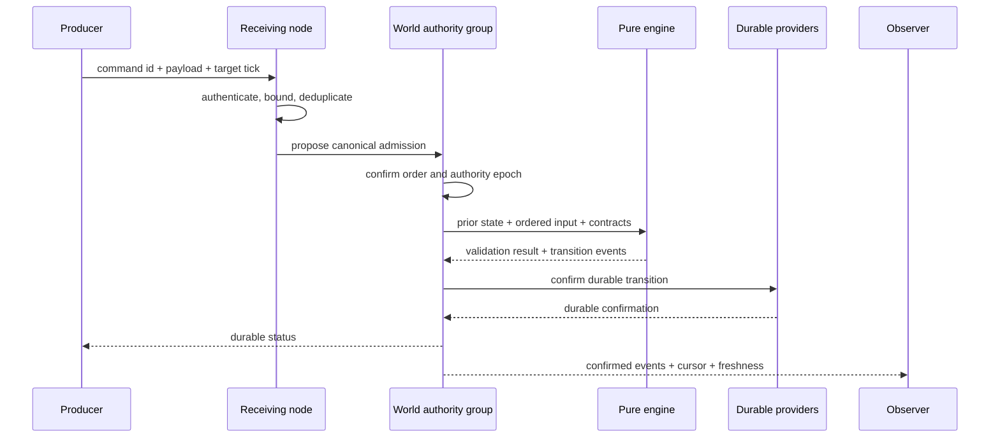

# Technical Architecture

```text
status: TARGET ARCHITECTURE WITH AN IMPLEMENTED LOCAL PROTOTYPE
```

This document maps the logical architecture to the repository. It must not be
read as a claim that distributed runtime components already exist.

## Component model

```text
NIV 0  sy_types · sy_config
          stable primitives and configuration values

NIV 1  sy_api
          commands, events, ports, public contract vocabulary

NIV 2  sy_core
          pure deterministic transitions and integrity rules

NIV 2b application plugins
          community-owned world capabilities through public contracts

NIV 3  sy_infra · sy_tools · sy_testkit · future sy_protocol
          storage, node networking, operational adapters, tests

NIV 4  server_d · future runtime/loader
          node process, provider composition, authority participation
```

The dependency direction protects the pure engine. The detailed current and
future edges are in [DEPENDENCY_RULES.md](DEPENDENCY_RULES.md).

## Logical boundaries

### Pure engine

`sy_core` validates and applies explicitly ordered transitions. It may depend
on stable types and API traits. It cannot perform network, filesystem, clock,
environment, process, or ambient randomness access.

### Kernel coordination

The logical kernel owns contracts for:

- world and node identity;
- simulated ticks and admitted command order;
- validation and in-world atomic transactions;
- durable command status and retained-history cursors;
- confirmed history and authority membership;
- execution-profile compatibility and migrations.

This responsibility spans pure logic and runtime coordination. It must not all
be placed inside `sy_core`.

### Node runtime

A node runtime wires the engine to approved providers. In the current prototype
`server_d` performs local wiring directly. The target runtime additionally
participates in world membership and distributed confirmation.

### Providers

Fundamental providers implement storage, tick scheduling, validation,
membership, replication, and related capabilities. Seej ships minimal reference
providers. Each can be replaced behind a frozen capability contract.

The target does not require arbitrary dynamic libraries. The first stable
release may use statically linked or startup-selected trusted providers. Future
hot loading and isolation must preserve the same logical contracts.

### Application plugins and consumers

Application plugins own optional world data and commands. Observers, tools,
renderers, and ingame clients consume public surfaces. None may access internal
state to bypass validation or confirmed ordering.

The inter-node protocol is a kernel infrastructure concern. Ingame netcode is a
separate application plugin and cannot become the replication protocol of the
world authority group.

## Distributed transition flow



An implementation may optimize the internal sequence, but it cannot publish a
canonical success before the required durable confirmation or let replicas
derive different transitions.

## Current repository mapping

Today:

- `sy_types`, `sy_api`, and `sy_core` provide the local state and transition
  vocabulary;
- `sy_infra` provides local FileStore, snapshot, and WAL behavior;
- `server_d` wires a single process and writer;
- `sy_cli` inspects local durable data;
- `sy_loader`, `sy_protocol`, and `mods/*` are not active implementations
  of the target provider ecosystem.

The current entity/zone types and degradation rules demonstrate recovery. They
are not the generic target model and must move behind public extension
boundaries before the contract freezes.

## Contract locations

- [CONTRACT.md](CONTRACT.md): public kernel guarantees and status vocabulary.
- [NODE_NETWORK.md](NODE_NETWORK.md): authority, quorum, replication, and reads.
- [PLUGIN_CONTRACT.md](PLUGIN_CONTRACT.md): capability, ownership, and lifecycle.
- [simulation/WORLD_SPEC.md](simulation/WORLD_SPEC.md): world-semantic model.
- [DATA_FLOW.md](DATA_FLOW.md): current and target processing flows.
- [phase1/EXIT_CHECKLIST.md](phase1/EXIT_CHECKLIST.md): evidence and open gaps.

No diagram, roadmap entry, or design paragraph closes a gap. Only the named
evidence in the checklist changes a target into an implemented guarantee.
